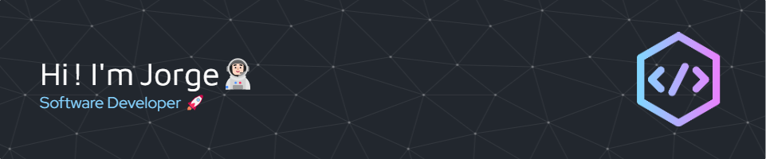

<h2>
Welcome to my GitHub Profile! 👋  
</h2>
  

<h2>About me</h2>

My name is Jorge Carrasco, and I'm from Spain. I'm studying a Computer Science Degree at <a href="https://www.unex.es/">UNEX</a>, and I'm looking for a trainee/junior position where I can consolidate all the things I've learned.

- 📚 I’m currently working on college and personal projects. You can know more about the latest checking <a href="https://jorgecarrascof.github.io/">my web resume</a>.
- 🌱 I’m currently learning React and Next.js by myself; as well as Java, C++ and SQL in college.
- 💭 I've also been in touch with some technologies as Angular, Electron, MongoDB and Astro.
- 💫 In the near future, I'd like to learn more about Python, React Native, Machine Learning, and more!
- 👯 I’m looking to collaborate on some projects where I can learn new topics, while I'm also being useful to the project.
- 🏖️ Some of my hobbies include:
- -  🔭 Learning new stuff
- -  🍃 Nature trips
- -  🎮 Videogames
- -  🎨 Design
- -  👾 Board game nights
- 💬 Ask me about anything you'd like to know about my personal project or preferred tools!
- 📫 How to reach me: you can message me at <a href="https://www.linkedin.com/in/jorge-carrasco-facundo">LinkedIn</a>, this GitHub and my personal mail (check my <a href="https://jorgecarrascof.github.io/">web resume</a> to find it).

